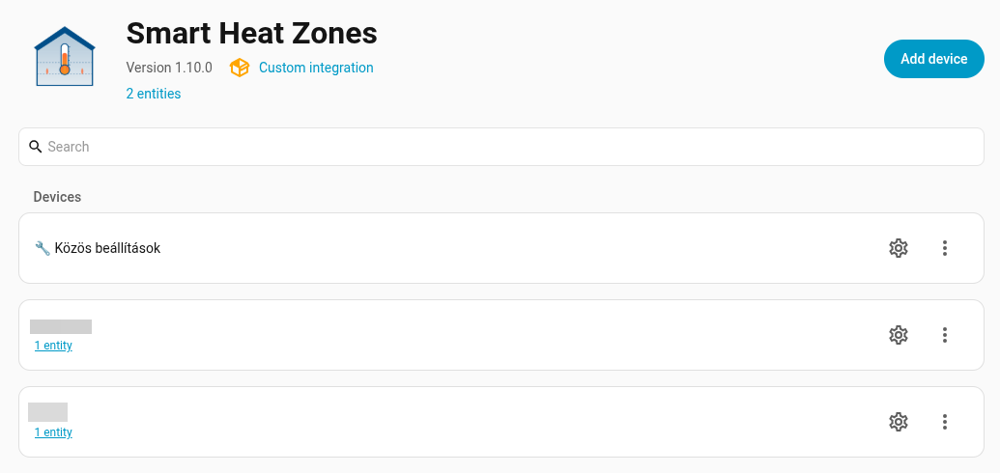
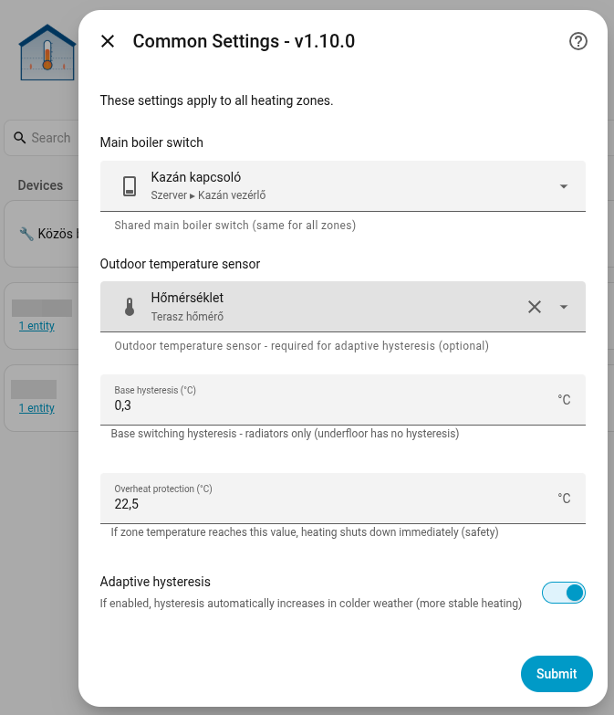
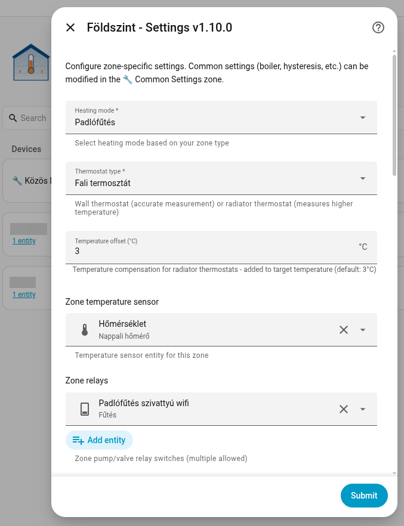
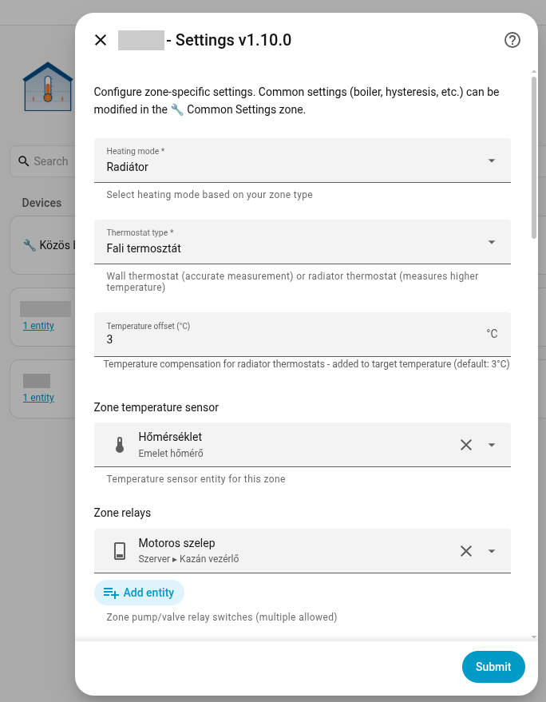

# SmartHeatZones v1.10.1

**Advanced Multi-Zone Heating Control for Home Assistant**

[](https://github.com/forreggbor/SmartHeatZones/releases)
[](https://www.home-assistant.io/)
[](https://my.home-assistant.io/redirect/hacs_repository/?owner=forreggbor&repository=SmartHeatZones&category=integration)
[](LICENSE)

**Author:** forreggbor
**Current Version:** 1.10.1
**Minimum HA Version:** 2025.10+

---

## Contents

- [Overview](#overview)
- [Key Features](#key-features)
- [Screenshots](#screenshots)
- [Installation](#installation)
- [Documentation](#documentation)
- [Support](#support)
- [License](#license)

---

## Overview

SmartHeatZones transforms your Home Assistant installation into an intelligent, multi-zone heating control system. It provides sophisticated thermostat functionality with support for different heating types (radiators vs. underfloor heating), adaptive hysteresis, schedule-based temperature control, and coordinated boiler management.

### What Problem Does It Solve?

Traditional heating systems often operate as a single zone, leading to:
- **Energy waste** from heating unoccupied rooms
- **Comfort issues** with different temperature needs in different areas
- **Complex wiring** when trying to implement zone control
- **Expensive hardware** for commercial multi-zone solutions

SmartHeatZones provides a **software-based solution** using your existing Home Assistant setup, temperature sensors, and relay switches.

### Who Is It For?

- Homeowners with multiple heating zones (floors, rooms, apartments)
- DIY enthusiasts building custom heating systems
- Anyone wanting intelligent, automated temperature control
- Users with mixed heating types (radiators and underfloor heating)
- People seeking to reduce heating costs through smart scheduling

---

## Key Features

### 🏠 Zone Management
- **Unlimited heating zones** - Create as many zones as needed
- **Independent control** - Each zone operates autonomously with its own settings
- **Radiator vs. underfloor heating** - Optimized control logic for each heating type
- **Zone-specific sensors** - Temperature, door/window sensors per zone
- **Multiple relays per zone** - Control pumps, valves, or multiple heating circuits

### 🔥 Intelligent Heating Control
- **Hysteresis-based control** - Prevents relay chattering and extends equipment life
- **Adaptive hysteresis** - Automatically adjusts based on outdoor temperature
- **Overheat protection** - Emergency shutdown at configurable temperature limit
- **Door/window detection** - Automatically pauses heating when windows open
- **Coordinated boiler management** - Shared boiler stays on while any zone needs heat

### 📅 Scheduling & Automation
- **Time-of-day schedules** - Up to 4 configurable periods per day per zone
- **5 preset modes** - Auto (schedule), Manual, Comfort, Eco, Away
- **Flexible scheduling** - Different temperatures for morning, day, evening, night
- **Schedule-based automation** - Automatically adjusts temperature throughout the day

### 🎛️ User Experience
- **100% GUI configuration** - No YAML editing required
- **Common settings** - Shared configuration across all zones (boiler, hysteresis, etc.)
- **Visual feedback** - Real-time status in Home Assistant UI
- **Persistent settings** - All configurations saved and restored after restart
- **Multi-language support** - Currently English and Hungarian, easily extensible

### 🔧 Advanced Capabilities
- **Event-based relay monitoring** - Instant detection of manual overrides
- **Auto-restart protection** - Prevents freezing if temperature drops too low
- **Debug logging** - Comprehensive logging for troubleshooting
- **State restoration** - Resumes operation after HA restart
- **Better Thermostat compatible** - Works with existing automations

---

### What's New in v1.9.1

#### Fixed issue v1.9.1 (BUGFIX)
- Removing the outdoor temperature sensor is not removed from settings

---

## Screenshots

| Integration page | Common settings |
|------------------|-----------------|
|  |  |

| Zone settings: underfloor heating | Zone settings: radiators |
|-----------------------------------|--------------------------|
|  |  |

---

## Installation

### Method 1: Marketplace / HACS (Recommended)

1. **Find the integration:**
   - Home Assistant 2026.11 or newer: open **Settings > Marketplace** and search for "Smart Heat Zones"
   - Older versions: open HACS, then "Integrations" and search for "Smart Heat Zones"
   - If it is not listed yet, add it from its GitHub link: **Custom repositories > Add from a GitHub link**
     (in HACS: the three dots menu (⋮) > "Custom repositories"), URL
     `https://github.com/forreggbor/SmartHeatZones`, category: Integration
   - The button at the top of this page opens the repository in your Home Assistant

2. **Install SmartHeatZones:**
   - Click "Download" and select the latest version
   - Restart Home Assistant

### Method 2: Manual Installation

1. **Download the integration:**
   - Download the latest release from GitHub
   - Extract the `smartheatzones` folder

2. **Copy to Home Assistant:**
   ```
   /config/custom_components/smartheatzones/
   ```
   
   The structure should be:
   ```
   custom_components/
   └── smartheatzones/
       ├── __init__.py
       ├── climate.py
       ├── config_flow.py
       ├── options_flow.py
       ├── const.py
       ├── boiler_manager.py
       ├── manifest.json
       ├── strings.json
       └── translations/
           ├── en.json
           └── hu.json
   ```

3. **Restart Home Assistant:**
   - Go to Developer Tools → Restart
   - Or perform a full host restart

4. **Clear browser cache:**
   - Press Ctrl+Shift+R (or Cmd+Shift+R on Mac)
   - This ensures the new UI loads correctly

### Verification

After restart, verify installation:
1. Go to Settings → Devices & Services
2. Click "Add Integration"
3. Search for "Smart Heat Zones"
4. If it appears, installation was successful

---

## Documentation

| Topic | Where |
|-------|-------|
| First setup of the integration and the first zone | [Getting started](docs/getting-started.md) |
| Common settings, zone options and daily use | [Configuration and usage](docs/configuration.md) |
| Adaptive hysteresis, piggyback heating, boiler management | [Advanced features](docs/advanced-features.md) |
| Thermostat card for the dashboard | [Lovelace UI](docs/lovelace.md), [button-card template](docs/lovelace-button-card-template.md) |
| How it works inside | [Architecture and technical details](docs/architecture.md) |
| Something does not work | [Troubleshooting and FAQ](docs/troubleshooting.md) |
| Contributing, versioning | [Development](docs/development.md) |
| What changed in each version | [CHANGELOG](CHANGELOG.md), older detailed notes in [docs/release-notes](docs/release-notes/) |

---

## Support

- **Issues:** https://github.com/forreggbor/SmartHeatZones/issues
- **Discussions:** https://github.com/forreggbor/SmartHeatZones/discussions

---

## License

MIT, see [LICENSE](LICENSE).

---

**Made with ❤️ for the Home Assistant community**
